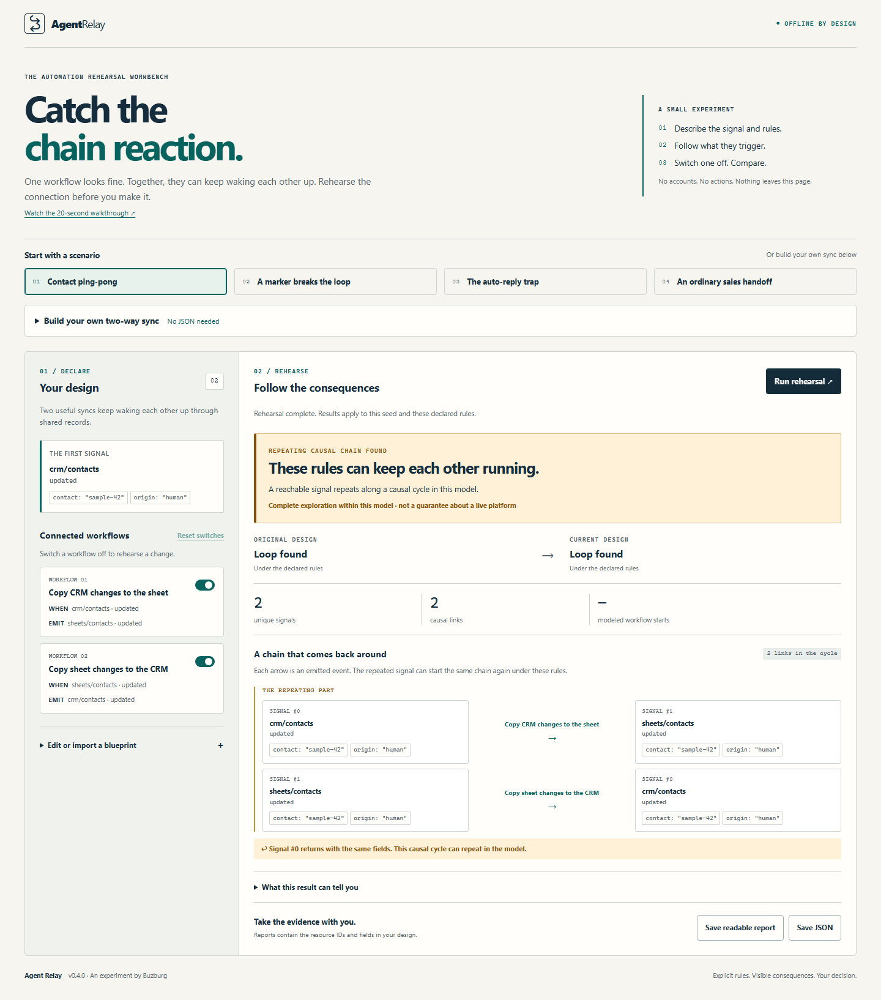

# Agent Relay ⚡

**Will your automations and agents keep waking each other up?**

A CRM update wakes a spreadsheet sync. The spreadsheet update wakes an AI agent. The agent writes back to the CRM. Both workflows look reasonable in isolation. Together, they repeat in an infinite loop, burning API quotas and thrashing production data.

Agent Relay rehearses that cross-system interaction **before you connect real accounts or deploy to production**. Describe triggers, emitted events, and field guards; see concrete repeating loop witnesses; simulate circuit breaks or marker guards, and verify two-way convergence — 100% offline with zero server calls.

[](LICENSE)
[](package.json)
[](tsconfig.json)
[](#no-account-no-cloud-zero-telemetry)
[](tests/)
[](https://github.com/Buzburg/Swarmojo)



---

## Try it in 5 seconds

**[Open the Live Web Simulator](https://buzburg.github.io/agent-relay/)** — no installation, account, or API key. The entire simulator runs 100% client-side in your desktop Chromium or Firefox browser. GitHub serves the static page; your blueprints never touch a server.

**[Watch the 20-second walkthrough](https://buzburg.github.io/agent-relay/demo.html)** &middot; [Download the MP4](https://github.com/Buzburg/agent-relay/releases/download/v0.4.0/trigger-tangle-20s.mp4). See a repeating sync, add a marker guard, and verify that useful changes still travel in both directions.

### Prefer to use it offline?

1. Download **[agent-relay.html from the latest release](https://github.com/Buzburg/agent-relay/releases/latest)**.
2. Open it in any modern browser. Zero installation, zero backend, and no internet connection needed.
3. Try built-in scenarios: **Contact ping-pong**, **Marker-guarded sync**, **Auto-reply loop**, or **Multi-agent handoff**.
4. Open **Build your own two-way sync** to declare resources and test origin markers visually without writing JSON.
5. Export a complete JSON verification proof or human-readable HTML audit report.

### No account, no cloud, zero telemetry.
The app never connects to your live accounts or runs live workflows. Blueprints, identifiers, and reports stay strictly on your local machine.

**This is an explicit design-time model checker, not an opaque scanner.** You supply the resource IDs and transition declarations. Results apply deterministically to the chosen seed and model bounds.

---

## What makes this useful?

- **External feedback matters.** Workflows and agents connect through exact resource and event identifiers, not only explicit "call next workflow" DAG nodes.
- **Concrete cycle witnesses.** A loop report includes the exact lead-in and a closed, repeating sequence of events with full field states at every step.
- **Guards are executable declarations.** Supported field checks can physically halt a modeled branch. An incorrectly placed marker does not magically make a loop disappear.
- **Reconvergence is not a loop.** Two branches reaching the same downstream signal are handled separately from a causal cycle.
- **Counts preserve duplicate deliveries.** On complete acyclic designs, report modeled workflow starts and emitted events using exact integers without loss from deduplication.
- **Limits stay visible.** Reaching the exploration budget produces an explicit incomplete result, never a misleading false clear.

---

## How It Works: Causal Loop Detection Architecture


---

## Use it in an Agent or Build Pipeline

Agent Relay includes a zero-dependency CLI that AI agents (such as [Swarmojo](https://github.com/Buzburg/Swarmojo)) and CI/CD pipelines can invoke as a deterministic test:

### 1. Agent Evaluation Harness

The **[Agent Relay Harness](docs/HARNESS.md)** compares an original baseline design against an agent's proposed candidate across operator-owned scenarios. Require an invoice draft, forbid an invoice send, and reject fixes that silently disable the useful work:

```sh
node dist/agent-relay-harness.mjs \
  --baseline examples/contact-loop.json \
  --candidate examples/guarded-sync.json \
  --suite examples/contact-suite.json
```

The command returns structured JSON evidence for both directions of the sync with deterministic cryptographic hashes.

### 2. Standalone CLI

Download `agent-relay.mjs` from the release. Requires **Node.js 22+**, with zero external package dependencies:

```sh
# Reproduce an infinite loop (Exit code 1 expected):
node agent-relay.mjs --example contact-loop

# Rehearse a change without modifying the blueprint on disk:
node agent-relay.mjs --example contact-loop --disable sheet-to-crm --format json

# Export an editable starting blueprint:
node agent-relay.mjs --example contact-loop --blueprint > blueprint.json

# Check your custom blueprint and generate an HTML report:
node agent-relay.mjs blueprint.json --format html > rehearsal.html
```

#### Deterministic Exit Codes
- **`0`**: Blueprint settles for the modeled seed (acyclic).
- **`1`**: Causal loop found in model (repeating cycle witness generated).
- **`2`**: Inconclusive within state/transition budget.
- **`3`**: Invalid input schema or syntax error.

---

## A Complete Blueprint Example

```json
{
  "version": 1,
  "name": "Contact ping-pong",
  "seed": {
    "resource": "crm/contacts",
    "event": "updated",
    "data": {"origin": "human"}
  },
  "workflows": [
    {
      "id": "crm-to-sheet",
      "name": "Copy contact to sheet",
      "on": {"resource": "crm/contacts", "event": "updated"},
      "emit": [{"resource": "sheets/contacts", "event": "updated"}]
    },
    {
      "id": "sheet-to-crm",
      "name": "Copy row to CRM",
      "on": {"resource": "sheets/contacts", "event": "updated"},
      "emit": [{"resource": "crm/contacts", "event": "updated"}]
    }
  ]
}
```

Adding an origin marker guard:
- Add `"set": {"origin": "contact-sync"}` to each emit effect.
- Add `"when": [{"field": "origin", "op": "notEquals", "value": "contact-sync"}]` to both workflows.
- Run `node agent-relay.mjs` &rarr; exit code changes from **1 (loop found)** to **0 (settles)**.

---

## The Buzburg Ecosystem

Agent Relay is part of the **Buzburg Suite** of sovereign developer tools:

- ⚡ **[Agent Relay](https://github.com/Buzburg/agent-relay)**: Rehearse how separate automations and agents relay events to each other before connecting real accounts.
- 🐝 **[Swarmojo](https://github.com/Buzburg/Swarmojo)**: The blazing-fast local-first AI agent meta-harness with sub-microsecond Mojo SIMD speed, Paperclip-grade org charts, hard budgets, and Swarmojo HUD.

---

## License & Authors

Licensed under the [MIT License](LICENSE). Built with craft by **[Buzburg AI](mailto:buzburgai@gmail.com)**.
