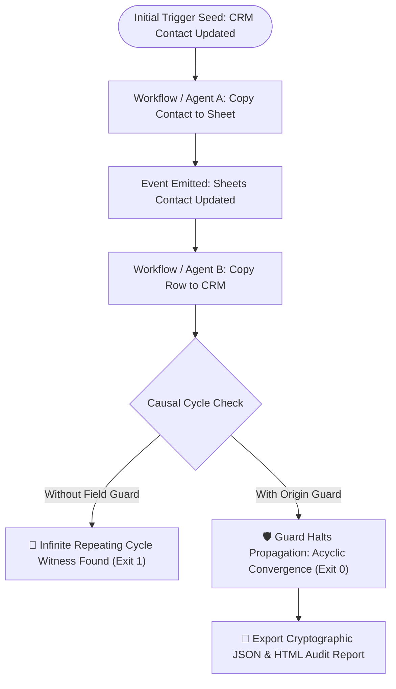

# Loop Guard 🛡️

**Rehearse how separate automations and AI agents relay events to each other — before connecting real accounts.**

[](LICENSE)
[](package.json)
[](tsconfig.json)
[](#no-account-no-cloud-zero-telemetry)
[](tests/)
[](https://github.com/Buzburg/Swarmojo)


---

### The 3:00 AM Webhook Nightmare

> **A HubSpot update wakes a Notion sync.** The Notion sync wakes an AI agent on Slack. The agent writes an update back to HubSpot. 
> 
> Each workflow looks completely reasonable in isolation. But together, they repeat in an infinite loop. By morning, **40,000 webhook events have fired**, third-party API quotas are completely burned, customer inboxes received 800 duplicate notifications, and your team faces a surprise platform bill.

**Loop Guard prevents this.** Rehearse cross-system automation and multi-agent interactions **offline in < 2 milliseconds** before connecting live accounts or deploying to production. Describe triggers, emitted events, and field guards; see concrete repeating loop witnesses; simulate circuit breaks or marker guards, and verify two-way convergence — 100% offline with zero server calls.

---

## 🚀 Quick Start: 3 Ways to Run (In 10 Seconds)

### 1. Instant Web Simulator (Zero Installation)
**[Open the Live Web Simulator](https://buzburg.github.io/loop-guard/)** — runs 100% client-side in any modern browser. GitHub serves the static page; your blueprints and data never leave your local machine.

- **[Watch the 20-second walkthrough](https://buzburg.github.io/loop-guard/demo.html)** &middot; [Download the MP4](https://github.com/Buzburg/loop-guard/releases/download/v0.4.0/trigger-tangle-20s.mp4)

### 2. Standalone Single-File App (Air-Gapped / Offline)
1. Download **[`loop-guard.html` from the latest release](https://github.com/Buzburg/loop-guard/releases/latest)**.
2. Double-click to open in Chrome, Firefox, or Safari. Zero installation, zero backend, and no internet connection required.
3. Use the built-in visual **Two-Way Sync Builder** to test origin markers without writing JSON.
4. Export cryptographic verification proofs and human-readable HTML audit reports.

### 3. Zero-Dependency Developer CLI (Node.js 22+)
Clone and run in seconds with zero external package dependencies:

```sh
# Clone the repository
git clone https://github.com/Buzburg/loop-guard.git
cd loop-guard && npm run build

# Reproduce an infinite loop in 1ms (Exit code 1):
node dist/loop-guard.mjs examples/zapier-hubspot-notion-loop.json

# Verify the origin marker guard fix (Exit code 0 - settles):
node dist/loop-guard.mjs examples/zapier-hubspot-notion-guarded.json

# Export a reproducible HTML audit report:
node dist/loop-guard.mjs examples/contact-loop.json --format html > report.html
```

---

## 🎯 Battle-Tested Real-World Scenarios

Loop Guard includes ready-to-run blueprints in the [`examples/`](examples/) folder modeling common real-world automation hazards:

| Scenario | What Happens Without Guard | The Intervention | Rehearsal Blueprint |
|---|---|---|---|
| **HubSpot & Notion Sync** | Zapier copies HubSpot deal to Notion; Notion sync triggers Zapier back to HubSpot. | Field guard checks `sync_source ≠ "zapier_sync"`, halting loop at step 1. | [`zapier-hubspot-notion-loop.json`](examples/zapier-hubspot-notion-loop.json)<br>[`zapier-hubspot-notion-guarded.json`](examples/zapier-hubspot-notion-guarded.json) |
| **Slack AI Agent & Jira Bot** | AI triage reads Slack and creates Jira issue; Jira webhook announces issue in Slack; AI triage reads announcement. | Filter guard `sender_type ≠ "bot"` ignores automated messages. | [`slack-jira-agent-storm.json`](examples/slack-jira-agent-storm.json)<br>[`slack-jira-agent-guarded.json`](examples/slack-jira-agent-guarded.json) |
| **Stripe & Billing Database** | Stripe webhook updates Postgres; DB trigger updates Stripe customer metadata. | Origin marker `update_origin ≠ "db_sync"` breaks the bounce. | [`stripe-webhook-cascade.json`](examples/stripe-webhook-cascade.json)<br>[`stripe-webhook-guarded.json`](examples/stripe-webhook-guarded.json) |
| **CRM & Google Sheets Ping-Pong** | Two bidirectional sync workflows endlessly bounce contact edits. | Origin marker halts propagation after one hop from either resource. | [`contact-loop.json`](examples/contact-loop.json)<br>[`guarded-sync.json`](examples/guarded-sync.json) |

---

## 📊 Why Loop Guard?

| Capability | Loop Guard | Live Sandbox Testing | Static DAG Linters | Staging Accounts |
|---|:---:|:---:|:---:|:---:|
| **100% Offline & Air-Gapped** | ✅ Zero Cloud Calls | ❌ Cloud-dependent | ✅ Local syntax | ❌ Requires staging infra |
| **Zero Cost / Zero Quota Burn** | ✅ Free & Instant | ❌ Burns API quotas | ✅ Free | ❌ Expensive to run |
| **Cross-System Loop Witnesses** | ✅ Exact Causal Trace | ❌ Only after loop explodes | ❌ Blind to external webhooks | ❌ Difficult to reproduce |
| **Executable Field Guards** | ✅ Exact Match & Semantics | ❌ Platform-specific | ❌ Limited | ❌ Trial-and-error |
| **Deterministic Execution** | ⚡ < 2ms | ⏳ Minutes to hours | ⚡ Fast | ⏳ Hours |
| **Cryptographic Audit Proof** | ✅ SHA-256 bound | ❌ Messy server logs | ❌ None | ❌ None |

---

## 🔍 How It Works: Causal Loop Detection Architecture



---

## 🤖 CI/CD & Agent Pipeline Integration

Loop Guard includes a zero-dependency CLI that AI agents (such as [Swarmojo](https://github.com/Buzburg/Swarmojo)) and CI/CD pipelines can invoke as a deterministic test:

### 1. Drop into GitHub Actions

Add this step to your CI pipeline (`.github/workflows/rehearse.yml`) to automatically reject pull requests that introduce webhook or agent loops:

```yaml
- name: Rehearse Automation Blueprints
  run: |
    node dist/loop-guard.mjs examples/guarded-sync.json
```

### 2. Autonomous Agent Evaluation Harness

The **[Loop Guard Harness](docs/HARNESS.md)** compares an original baseline design against an agent's proposed candidate across operator-owned scenarios. Require an invoice draft, forbid an invoice send, and reject fixes that silently disable the useful work:

```sh
node dist/loop-guard-harness.mjs \
  --baseline examples/contact-loop.json \
  --candidate examples/guarded-sync.json \
  --suite examples/contact-suite.json
```

The command returns structured JSON evidence for both directions of the sync with deterministic cryptographic hashes.

### 3. Deterministic Exit Codes

- **`0`**: Blueprint settles for the modeled seed (acyclic convergence).
- **`1`**: Causal loop found in model (repeating cycle witness generated).
- **`2`**: Inconclusive within state/transition budget.
- **`3`**: Invalid input schema or syntax error.

---

## 📝 Blueprint Specification

Blueprints are declared as compact, readable JSON:

```json
{
  "version": 1,
  "name": "Contact ping-pong",
  "seed": {
    "resource": "crm/contacts",
    "event": "updated",
    "data": {"origin": "human"}
  },
  "workflows": [
    {
      "id": "crm-to-sheet",
      "name": "Copy contact to sheet",
      "on": {"resource": "crm/contacts", "event": "updated"},
      "emit": [
        {
          "resource": "sheets/contacts",
          "event": "updated",
          "set": {"origin": "contact-sync"}
        }
      ],
      "when": [
        {"field": "origin", "op": "notEquals", "value": "contact-sync"}
      ]
    },
    {
      "id": "sheet-to-crm",
      "name": "Copy row to CRM",
      "on": {"resource": "sheets/contacts", "event": "updated"},
      "emit": [
        {
          "resource": "crm/contacts",
          "event": "updated",
          "set": {"origin": "contact-sync"}
        }
      ],
      "when": [
        {"field": "origin", "op": "notEquals", "value": "contact-sync"}
      ]
    }
  ]
}
```

---

## 🔒 Security & Privacy Guarantees

- **No account connection, no cloud, zero telemetry**: Blueprints, identifiers, and reports stay strictly on your local machine.
- **Self-contained HTML**: The browser workbench is bundled into a single file with strict Content Security Policy (`default-src 'none'`) and inline cryptographic SRI hashes.
- **Deterministic state model**: Explores reachable states breadth-first with strict budgets, never hallucinating transitions.

---

## 🌐 The Buzburg Ecosystem

Loop Guard is part of the **Buzburg Suite** of sovereign developer tools:

- 🛡️ **[Loop Guard](https://github.com/Buzburg/loop-guard)**: Rehearse how separate automations and agents relay events to each other before connecting real accounts.
- 🐝 **[Swarmojo](https://github.com/Buzburg/Swarmojo)**: The blazing-fast local-first AI agent meta-harness with sub-microsecond Mojo SIMD speed, Paperclip-grade org charts, hard budgets, and Swarmojo HUD.

---

## 📜 License & Authors

Licensed under the [MIT License](LICENSE). Built with craft by **[Buzburg AI](mailto:buzburgai@gmail.com)**.
